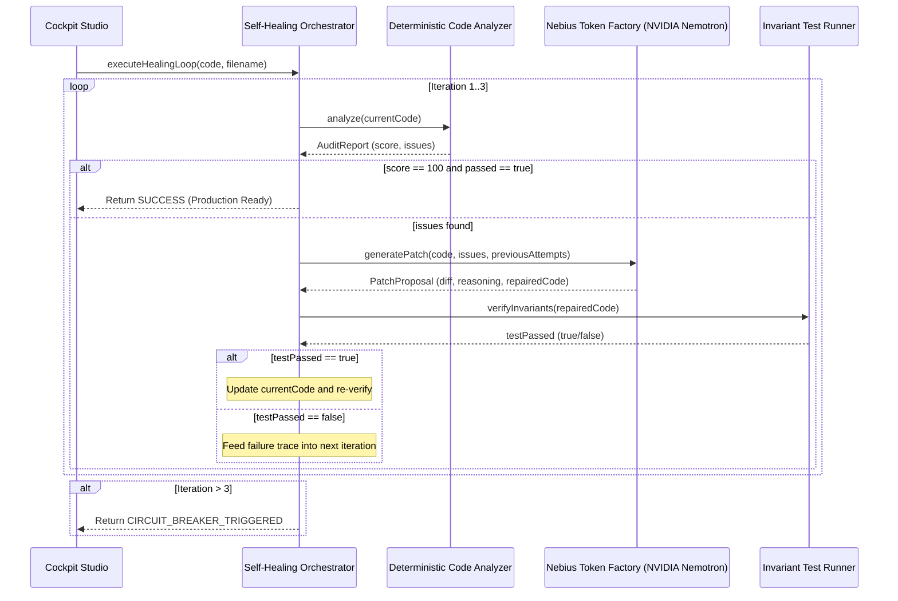

# 🏛️ Nebius CodeSentinel — System Architecture & Invariants

## 1. Technical Stack & Isolation
- **Directory**: `projects/nebius-nvidia-agent/` (Strictly isolated workspace).
- **Core Orchestrator**: TypeScript, Node.js, Zod 3.x contracts.
- **Frontend / Cockpit**: Next.js 15 (App Router), Tailwind CSS, Lucide React.
- **Inference Cloud**: Nebius Token Factory (`https://api.studio.nebius.ai/v1/`).
- **Primary Model**: NVIDIA Nemotron-3 Super 120B (`nvidia/nemotron-3-super-120b`).
- **Fallback Resilience Model**: Meta Llama 3.1 70B (`meta-llama/Meta-Llama-3.1-70B-Instruct`).

---

## 2. Invariant Rules & Audit Dimensions (Recycled from n8n & GitLab Sentinel)

1. **Security Invariant (`SEC-001`)**:
   - Zero hardcoded plaintext credentials (Bearer tokens, `sk-` keys, `ghp_` PATs, database passwords).
   - Penalty: $-30$ points, severity `CRITICAL`.
2. **HITL Governance Invariant (`GOV-001`)**:
   - Direct external communication dispatchers (Slack, Discord, SendGrid, Twilio) must be protected by Human-in-the-Loop verification gates.
   - Penalty: $-15$ points, severity `HIGH`.
3. **Expression Syntax Invariant (`SYN-001`, `SYN-002`)**:
   - Proper prefixing of `$json` in n8n and pipeline expressions.
   - Elimination of empty `{{ }}` blocks.
   - Penalty: $-10$ points, severity `MEDIUM`.
4. **Architectural Invariant (`DEP-001`)**:
   - Detection of deprecated components (`basicLLMChain`, `eval`).
   - Penalty: $-15$ points, severity `HIGH`.

---

## 3. Self-Healing Loop & Circuit Breaker

---

## 4. Dual-Mode Runtime (Live Nebius vs High-Fidelity Simulation)

Adhering strictly to **Rule 3 (Intégrité & Zéro Faux Positif)** of `hackathon-architect`:
- **When `NEBIUS_API_KEY` is present**: The client communicates directly with Nebius Token Factory over HTTP via `OpenAI` client SDK configured to `https://api.studio.nebius.ai/v1/`.
- **When `NEBIUS_API_KEY` is omitted or `MOCK_MODE=true`**: The client executes deterministic high-fidelity code repair labeled explicitly as `MOCK_SIMULATED`, allowing continuous zero-credit development and jury review.
