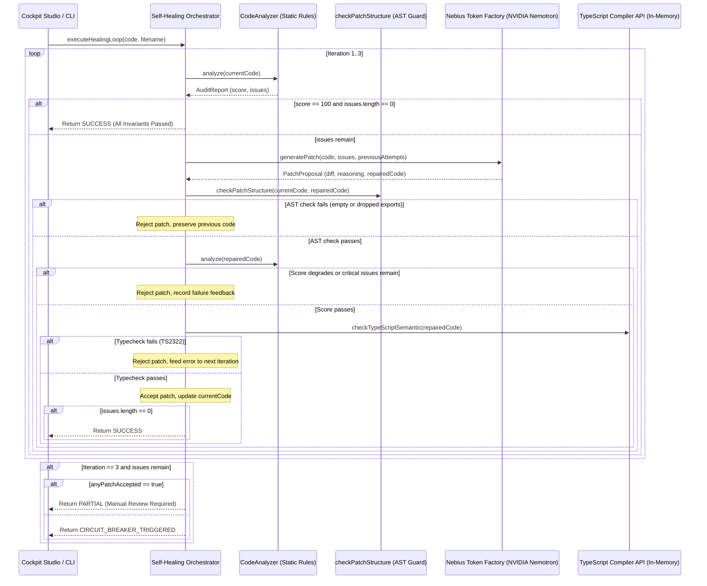

# 🏛️ Nebius CodeSentinel — System Architecture & Invariants

## 1. Technical Stack & Isolation
- **Repository layout**: The standalone repository root contains `package.json`, `src/`, `LICENSE` and `JUDGE_TESTING.md`.
- **Core Orchestrator**: TypeScript, Node.js, Zod 3.x schema contracts, TypeScript Compiler API.
- **Frontend / Cockpit**: Next.js 15 (App Router), Tailwind CSS, Lucide React icons.
- **Inference Cloud**: Nebius Token Factory (`https://api.tokenfactory.nebius.com/v1/`).
- **Primary Model**: NVIDIA Nemotron-3 Super 120B (`nvidia/nemotron-3-super-120b-a12b`).
- **Fallback Resilience Model**: NVIDIA Nemotron-3 Nano 30B (`nvidia/NVIDIA-Nemotron-3-Nano-30B-A3B`).
- **Bounded Inference Client**: Max 4,000 output tokens per request, 0 automatic SDK retries, 8,192-byte serialized payload limit, 2-request per-run budget.

---

## 2. Invariant Rules & Audit Dimensions

1. **Security Invariant (`SEC-001`)**:
   - Zero hardcoded plaintext credentials (Bearer tokens, `sk-` keys, `ghp_` PATs, database passwords).
   - Penalty: $-30$ points, severity `CRITICAL`.
2. **HITL Governance Invariant (`GOV-001`)**:
   - Direct external communication dispatchers (Slack, Discord, SendGrid, Twilio, Gmail) must be gated by a conditional Human-in-the-Loop check (e.g., `if (await verifyHumanApproval(...))`, `if (event.approved)`). Simple string or identifier presence is rejected.
   - Penalty: $-15$ points, severity `HIGH`.
3. **Expression Syntax Invariant (`SYN-001`, `SYN-002`)**:
   - Proper prefixing of `$json` in n8n and automation expressions.
   - Elimination of empty `{{ }}` placeholder blocks.
   - Penalty: $-10$ points, severity `MEDIUM`.
4. **Architectural Deprecation Invariant (`DEP-001`)**:
   - Detection of unsafe or deprecated components (`basicLLMChain`, dynamic `eval()`).
   - Penalty: $-15$ points, severity `HIGH`.

---

## 3. Structural Preservation & Verification Layers

Before any model-proposed repair can be applied:

1. **AST Structural Guard (`checkPatchStructure`)**:
   - Parses candidate code with the TypeScript Compiler API.
   - Rejects blank or empty candidates.
   - Rejects proposals that delete or alter signatures of exported functions (such as `handlePayment`), ensuring external API contracts remain intact.
2. **Deterministic Static Audit (`CodeAnalyzer.analyze`)**:
   - Re-audits candidate code against `SEC-001`, `GOV-001`, `SYN-001`, and `DEP-001`.
   - Score non-regression guard: candidate is rejected if the compliance score drops.
3. **TypeScript Semantic Compilation (`createFixtureVerifier`)**:
   - Performs in-memory compilation using `ts.createProgram`.
   - Rejects candidate if semantic diagnostics reveal type errors (e.g. TS2322).
4. **Outcome Status Distinction**:
   - `SUCCESS`: Zero outstanding configured findings.
   - `PARTIAL`: An improvement was accepted without score regression, but targeted findings remain open. Requires manual review and CLI `--apply` will not overwrite files.
   - `CIRCUIT_BREAKER_TRIGGERED`: Proposed patches continually fail validation after 3 iterations. Previous source code is strictly preserved.
5. **Security Isolation**:
   - Model-generated code is **never executed** within the host process (`NOT_VERIFIED`).

---

## 4. Self-Healing Loop Sequence

---

## 5. Dual-Mode Runtime & Provenance Tracking

- **Simulation Mode (`MOCK_SIMULATED`)**: Active by default when `MOCK_MODE=true` or when no API key is supplied. Runs deterministic local repairs with zero external requests to allow free and reproducible jury evaluation.
- **Live Nebius Mode (`LIVE_NEBIUS`)**: Active only when `MOCK_MODE=false`, `ENABLE_LIVE_REPAIR=true`, and a valid `NEBIUS_API_KEY` is configured. Connects to `https://api.tokenfactory.nebius.com/v1/` with a 2-request per-run budget.
- **Recorded Proof**: A verified live run on October 28, 2026, is stored in `docs/live-proof-20261028/` with exact provider response ID (`chatcmpl-aa293e018d7955bb`) and token usage.
