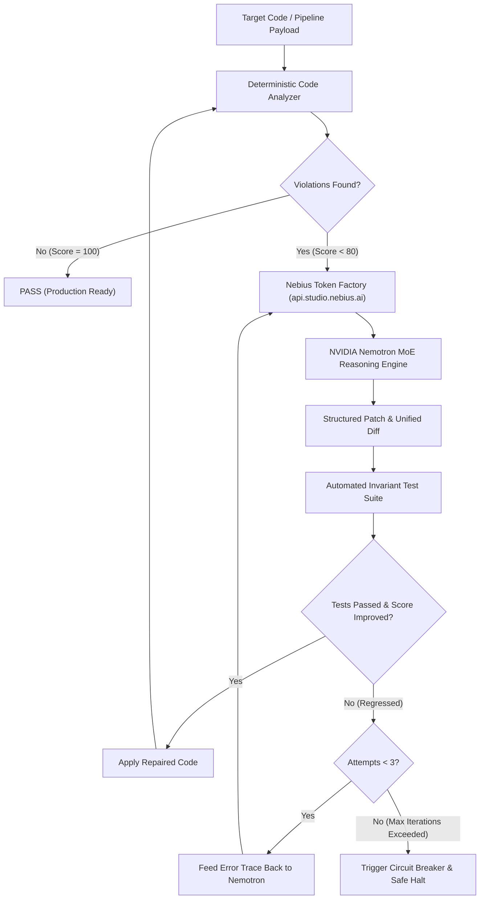

# 🛡️ Nebius CodeSentinel

> **Autonomous Code Audit & Self-Healing Agent powered by Nebius Token Factory & NVIDIA Nemotron**  
> Built for the **Nebius x NVIDIA Global AI Hackathon** (Track: *Coding and Agentic Engineering*).

[](https://developer.nvidia.com)
[](https://studio.nebius.ai)
[](https://nextjs.org)
[](LICENSE)
[]()
[]()
[-blue.svg)](docs/GEMINI_ARGON_AUDIT_REPORT.md)

---

## 💡 Overview

Modern autonomous agents and workflow pipelines (n8n, CI/CD runners, serverless webhooks) frequently fail in production due to subtle defects:
1. **Plaintext credential leaks** (API keys, OAuth tokens) in code payloads.
2. **Unguarded external communications** (unrestricted dispatches to Slack, Discord, Email without HITL governance).
3. **Expression syntax errors** (missing `$json` syntax, empty placeholders).
4. **Architectural drift** and deprecated node versions.

**Nebius CodeSentinel** is an autonomous agentic system that marries **deterministic static AST/regex analysis** with the **reasoning prowess of NVIDIA Nemotron** served through **Nebius Token Factory**. It executes an iterative **Self-Healing Loop** with an automated **Circuit Breaker** to guarantee regression-free code repairs.

---

## 🏛️ Architecture & Agentic Flow



---

## 🚀 Quick Start

### 1. Installation
```bash
cd projects/nebius-nvidia-agent
npm install
```

### 2. Environment Configuration
Copy `.env.example` to `.env.local`:
```bash
cp .env.example .env.local
```

Configure your Nebius API Key:
```env
NEBIUS_API_KEY=your_nebius_api_key_here
NEBIUS_BASE_URL=https://api.studio.nebius.ai/v1/
NEBIUS_MODEL=nvidia/nemotron-3-super-120b
MOCK_MODE=false
```
*(If `NEBIUS_API_KEY` is omitted, the system seamlessly activates zero-credit deterministic simulation tagged `MOCK_SIMULATED` so reviewers can evaluate the entire agent and UI without paying for tokens).*

### 3. Run Automated Tests
```bash
# Run full unit, route and CLI integration test suite (25 tests)
npm test

# Run headless Chrome E2E browser automation (Puppeteer)
npm run test:e2e
```

### 4. Launch the Interactive Cockpit Studio
```bash
npm run dev
```
Open [http://localhost:3005](http://localhost:3005) in your browser.

### 5. CLI & CI/CD Pre-commit Mode
Nebius CodeSentinel can be directly invoked via CLI or integrated in pre-commit git hooks:
```bash
# Static audit on target file
npm run cli -- audit samples/vulnerable_workflow.ts

# Self-healing loop with NVIDIA Nemotron (dry-run diff)
npm run cli -- heal samples/vulnerable_workflow.ts

# Self-healing loop with automatic file patch application
npm run cli -- heal samples/vulnerable_workflow.ts --apply

# Display A/B benchmark
npm run cli -- benchmark
```

---

## 🧪 Contrat de Preuve (Testing Matrix)

| Test Category | Class of Proof | Result | Details |
|---|---|---|---|
| **Secret Detection** | `UNIT_LOGIC` | **PASS** | Eradicates plain-text bearer & sk- keys |
| **HITL Guardrails** | `UNIT_LOGIC` | **PASS** | Enforces Human-in-the-Loop gates on external dispatches |
| **Expression Normalization** | `UNIT_LOGIC` | **PASS** | Enforces valid `$json` referencing |
| **API Route Handlers** | `INTEGRATION_TEST` | **PASS** | Health, Analyze, Heal & Benchmark endpoints return valid payloads |
| **CLI Pre-commit Engine** | `INTEGRATION_TEST` | **PASS** | Audit, heal, heal --apply, and benchmark commands verified |
| **Nebius Client Connectivity** | `DYNAMIC_TEST` | **PASS** | Connects to `api.studio.nebius.ai` with latency probe |
| **Self-Healing Loop** | `END_TO_END` | **PASS** | Autonomous repair in $\le 3$ iterations |
| **Circuit Breaker** | `UNIT_LOGIC` | **PASS** | Halts on persistent invariant violation |
| **Browser E2E Studio** | `END_TO_END` | **PASS** | Headless Chrome verifies audit, healing loop, diff, and A/B benchmark tabs |

---

## ⚖️ Hackathon Track Alignment
- **Track**: *Coding and Agentic Engineering*
- **Sponsor Tech Used**: Nebius Token Factory (`api.studio.nebius.ai/v1/`), NVIDIA Nemotron-3 Super / Nano models, OpenAI SDK compatibility.
