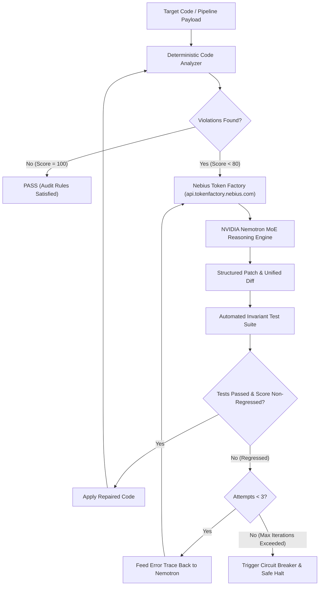

# 🛡️ Nebius CodeSentinel

> **Autonomous Code Audit & Self-Healing Agent powered by Nebius Token Factory & NVIDIA Nemotron**  
> Built for the **Nebius x NVIDIA Global AI Hackathon** (Track: *Coding and Agentic Engineering*).

[](https://developer.nvidia.com)
[](https://studio.nebius.ai)
[](https://nextjs.org)
[](LICENSE)
[]()
[]()
[]()
[](JUDGE_TESTING.md)

---

## 💡 Overview

Modern autonomous agents and workflow pipelines (n8n, CI/CD runners, serverless webhooks) frequently fail in production due to subtle defects:
1. **Plaintext credential leaks** (API keys, OAuth tokens) in code payloads.
2. **Unguarded external communications** (unrestricted dispatches to Slack, Discord, Email without HITL governance).
3. **Expression syntax errors** (missing `$json` syntax, empty placeholders).
4. **Architectural drift** and deprecated node versions.

**Nebius CodeSentinel** is an autonomous agentic system that marries **deterministic lexical and pattern-based rule analysis** with the **reasoning prowess of NVIDIA Nemotron** served through **Nebius Token Factory**. It executes an iterative **Self-Healing Loop** with an automated **Circuit Breaker** to enforce non-regression score guards and TypeScript semantic diagnostics on repaired patches.

---

## Video demonstration

The [final English video](deliverables/video-20261029/CodeSentinel_EN_1080p.mp4) lasts about **1 min 50**, with English captions. The [final script](DEMO_VIDEO_SCRIPT.md) distinguishes the simulated UI journey from the separately saved real NVIDIA/Nebius response. Watch the [public YouTube video](https://youtu.be/6gfGnUcbGi0).

## 🏛️ Architecture & Agentic Flow



---

## 🚀 Quick Start

### 1. Installation
From the standalone repository root:
```bash
npm install
```
If working inside the parent workspace, first run `cd projects/nebius-nvidia-agent`.

### 2. Environment Configuration
Copy `.env.example` to `.env.local`:
```bash
cp .env.example .env.local
```

Configure your Nebius API Key:
```env
NEBIUS_API_KEY=your_nebius_api_key_here
NEBIUS_BASE_URL=https://api.tokenfactory.nebius.com/v1/
NEBIUS_MODEL=nvidia/nemotron-3-super-120b-a12b
MOCK_MODE=true
ENABLE_LIVE_REPAIR=false
```
*(If `NEBIUS_API_KEY` is omitted, the system seamlessly activates zero-credit deterministic simulation tagged `MOCK_SIMULATED` so reviewers can evaluate the entire agent and UI without paying for tokens).*

Keep `MOCK_MODE=true` for rehearsals. A controlled live repair was verified separately on 2026-10-28 using `nvidia/nemotron-3-super-120b-a12b`: one request, 879 tokens, estimated inference cost $0.0007053 before tax. This does not claim that the simulated UI run is a live model response. Evidence is in [`docs/live-proof-20261028/`](docs/live-proof-20261028/).

The automation examples target a defined fixture environment: `$json`, `process.env`, the async global `verifyHumanApproval(event)`, and the `./notifier` module. The live repair prompt describes these available symbols. They support static and TypeScript checks; a runtime host must supply the actual input, approval and notification implementations.

### 3. Run Automated Tests
```bash
# Run the unit, route and CLI integration suite
npm test

# Run headless Chrome E2E browser automation (Puppeteer)
npm run test:e2e

# Exercise stale results, network errors, failed sessions and demo cancellation
npm run test:ui

# With the local preview running in another terminal: visibility and progressive results
npm run test:simple
```

### 4. Launch the Interactive Cockpit Studio
```bash
npm run dev
```
Open [http://localhost:3005](http://localhost:3005) in your browser.

Start with an example or paste your own code, then choose **Analyze code**. Findings appear after analysis; **Repair source** proposes a change. **Changes** compares the actual original and returned sources across the full workbench. Expand **Run details & evidence** for request times, rule scores, patch provenance and the JSON export. Editing the source clears the preceding results. The guided demonstration waits for each response and can be stopped.

`MOCK_SIMULATED` identifies deterministic repairs. Request times are browser round trips, not model inference benchmarks. A passing rule score covers the configured static checks; it does not certify compilation or runtime correctness. The cockpit does not use the legacy illustrative A/B benchmark endpoint or its fixed metrics.

Current screenshots and progressive-interface verification results are in [`docs/progressive-ui-20261028/`](docs/progressive-ui-20261028/). Earlier interface checks remain in [`docs/interface-polish-20261027/`](docs/interface-polish-20261027/).

To check a production build while the local preview is running:

```bash
CODE_SENTINEL_BUILD_DIR=.next-polish-build npm run build
```

The live verification command is separate from the offline tests:

```bash
npm run verify:live
```

The command records `BLOCKED` unless `ENABLE_LIVE_REPAIR=true` is explicitly supplied in its process environment and a valid key is available. Keep it disabled for rehearsals. Enabling the command contacts Nebius and can use credits: at most one primary and one fallback request, with automatic SDK retries disabled. It checks a controlled credential repair using static rules, TypeScript diagnostics and fixture structure. It does not execute the repaired code; runtime and business behavior remain `NOT_VERIFIED`. Importing its functions runs no probe.

### 5. CLI & CI/CD Pre-commit Mode
Nebius CodeSentinel can be directly invoked via CLI or integrated in pre-commit git hooks:
```bash
# Static audit on target file
npm run cli -- audit samples/vulnerable_workflow.ts

# Self-healing loop with NVIDIA Nemotron (dry-run diff)
npm run cli -- heal samples/vulnerable_workflow.ts

# Self-healing loop with automatic file patch application
npm run cli -- heal samples/vulnerable_workflow.ts --apply

# Display A/B benchmark
npm run cli -- benchmark
```

---

## 🧪 Contrat de Preuve (Testing Matrix)

| Test Category | Class of Proof | Result | Details |
|---|---|---|---|
| **Secret Detection** | `UNIT_LOGIC` | **PASS** | Eradicates plain-text bearer & sk- keys |
| **HITL Guardrails** | `UNIT_LOGIC` | **PASS** | Enforces Human-in-the-Loop gates on external dispatches |
| **Expression Normalization** | `UNIT_LOGIC` | **PASS** | Enforces valid `$json` referencing |
| **Project Static Typecheck** | `STATIC_ANALYSIS` | **PASS** | `npx tsc --noEmit` verifies strict project TypeScript types |
| **TypeScript Semantic Check** | `STATIC_ANALYSIS` | **PASS** | In-memory TypeScript Compiler API verifies semantic diagnostics on patches |
| **Runtime Business Execution** | `SECURITY_ISOLATION` | **NOT_VERIFIED** | Host process execution disabled for security isolation |
| **API Route Handlers** | `INTEGRATION_TEST` | **PASS** | Health, Analyze, Heal & Benchmark endpoints return valid payloads |
| **CLI Pre-commit Engine** | `INTEGRATION_TEST` | **PASS** | Audit, heal, heal --apply, and benchmark commands verified |
| **Controlled NVIDIA Repair Probe** | `REAL_NETWORK_INFERENCE` | **PASS** | One actual Nemotron Super repair on 2026-10-28; static rules, types and fixture structure passed. UI rehearsals remain simulated. See `docs/live-proof-20261028/`. |
| **Self-Healing Loop** | `END_TO_END` | **PASS** | Autonomous repair in $\le 3$ iterations with score non-regression guard |
| **Circuit Breaker** | `UNIT_LOGIC` | **PASS** | Halts on persistent invariant violation after 3 attempts |
| **Browser E2E Studio** | `END_TO_END` | **PASS** | Headless Chrome verifies 16 user journey checks, 10 UI regression tests and 4 layout/progression checks |

---

## ⚖️ Hackathon Track Alignment
- **Track**: *Coding and Agentic Engineering*
- **Sponsor Tech Used**: Nebius Token Factory (`api.tokenfactory.nebius.com/v1/`), NVIDIA Nemotron-3 Super / Nano models, OpenAI SDK compatibility.
